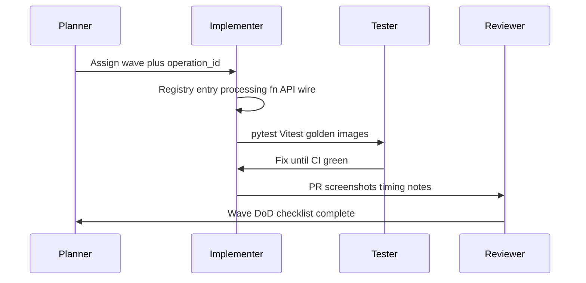

# Computer Vision Processing Lab — Implementation Plan

**Version:** 1.0  
**Status:** Roadmap (greenfield → MVP)  
**Scope reference:** [project-scope.md](./project-scope.md)  
**Language:** English (UI and technical docs align with scope §4)

---

## 1. Purpose

This document defines **how** the project will be built: wave-based delivery, shared technical patterns, acceptance gates, deployment (Vercel + Railway), and an **agentic development layer** so humans and coding agents can implement algorithms incrementally without breaking contracts.

**Out of scope for this file:** application source code. Code begins in **Wave 0** when implementation starts.

---

## 2. Current state and target

| Aspect | Today | MVP target |
|--------|--------|------------|
| Repository | `README.md`, `docs/project-scope.md` only | Full monorepo per scope §3.2 |
| Modules | Specified (M01–M08) | All modules functional with configurable parameters |
| Differentiator | FFT module specified | FFT spectrum, LPF/HPF, IFFT reconstruction validated |
| Science | Three experiments defined | Documented under `experiments/` with reproducible configs |
| Quality | Specified (pytest, Vitest, Playwright, CI) | Green CI on main; core algorithms tested |
| Deploy | — | Frontend on Vercel; API on Railway (or Fly.io equivalent) |

---

## 3. Delivery model: waves

Waves are **sequential gates**. Work inside a wave may run in parallel (backend processing vs frontend module UI), but the next wave should not start until the previous wave **Definition of Done (DoD)** is met.

**Critical path:** Wave 0 → 1 → … → 6 (FFT numerical gate) → 7 → 8 → 9.


### 3.1 Wave overview

| Wave | Name | Scope module | Primary deliverable |
|------|------|--------------|---------------------|
| 0 | Foundation & agentic toolchain | §3, §5, CI | Monorepo scaffold, contracts, CI skeleton, agent docs plan |
| 1 | Image input & lab shell | M01, §4 layout | Upload, metadata, side-by-side viewers, zoom, reset, PNG download |
| 2 | Color space processing | M02 | RGB/HSV/LAB, channels, B/C/gamma, histograms (Plotly) |
| 3 | Spatial filtering | M03 | Six filters, kernel/sigma controls, processing time |
| 4 | Edge detection | M04 | Sobel, Prewitt, Laplacian, Canny; binary edge display |
| 5 | Threshold & morphology | M05 | Thresholds, morph ops, connected-component count |
| 6 | Frequency domain (FFT) | M06 | FFT2, log magnitude spectrum, LPF/HPF, IFFT, spatial vs spectral compare |
| 7 | Algorithm comparison | M07 | Dual-run compare API/UI; PSNR, SSIM, MSE when reference exists |
| 8 | Experiment export & science | M08, §6 | JSON/CSV/PNG export, config replay, experiments A/B/C |
| 9 | Hardening & deploy | §9, §10 | E2E, portfolio README, Vercel + Railway, demo storyboard |

### 3.2 Mapping to scope sprints

| Scope sprint (§7) | Waves included | Stakeholder milestone |
|-------------------|----------------|------------------------|
| Sprint 1 | 0, 1, 2 | Basic app: upload, visualization, color, histograms |
| Sprint 2 | 3, 4, 5 | Core classical CV library (spatial, edges, morphology) |
| Sprint 3 | 6 | Advanced FFT module |
| Sprint 4 | 7, 8, 9 | Compare, metrics, export, experiments, tests, deploy |

Duration is capacity-driven; waves may span partial sprints if needed.

---

## 4. Repository layout (target)

```
computer-vision-processing-lab/
├── frontend/                 # Next.js + TypeScript + Tailwind + shadcn/ui
│   ├── app/                  # Routes per module
│   ├── components/           # Viewers, param panels, charts
│   ├── lib/                  # API client, image utils
│   └── types/                # Shared TS contracts
├── backend/                  # FastAPI
│   ├── app/
│   │   ├── api/              # HTTP routes
│   │   ├── core/             # Config, validation, CORS, limits
│   │   ├── processing/       # Pure CV algorithms (+ registry.yaml)
│   │   ├── metrics/          # PSNR, SSIM, MSE, timing
│   │   └── schemas/          # Pydantic request/response models
│   └── tests/
├── samples/                  # Redistributable example images + README (licenses)
├── experiments/              # Protocols, configs, results (Wave 8)
├── docs/
│   ├── project-scope.md
│   ├── implementation-plan.md  # this file
│   ├── architecture.md       # Wave 0–1
│   ├── api-contract.md       # Wave 0–1
│   ├── agent-playbook.md     # Wave 0
│   └── adding-an-operation.md
├── AGENTS.md                 # Agent/human entrypoint (Wave 0)
├── .cursor/rules/            # Cursor rules (Wave 0)
├── .github/workflows/ci.yml
└── docker-compose.yml        # Optional local full stack (recommended)
```

---

## 5. Technical spine (non-negotiable)

These patterns apply from Wave 0 onward. Agents must not bypass them when adding algorithms.

### 5.1 Separation of concerns

- **`processing/`:** Pure NumPy/OpenCV/scikit-image logic. **No** FastAPI, HTTP, or UI imports.
- **`api/`:** Decode requests, call processing, encode responses, map errors to HTTP status.
- **`frontend/`:** Presentation and parameter UX only; no duplicate algorithm implementations.

Each processor returns a structured result, e.g.:

```python
@dataclass
class ProcessResult:
    image: np.ndarray           # BGR or grayscale, documented per operation
    processing_ms: float
    aux: dict | None = None     # histograms, spectrum grids, component counts, etc.
    metadata: dict | None = None
```

### 5.2 Operation registry (single source of truth)

**File:** `backend/app/processing/registry.yaml`

Each entry includes:

- `id` — stable snake_case identifier (e.g. `spatial_gaussian_blur`)
- `module` — `color` | `spatial` | `edges` | `morphology` | `frequency` | …
- `name`, `description` — short EN strings for UI tooltips
- `params` — list of `{ name, type, default, min, max, step, enum? }`
- `output_kind` — `image` | `mask` | `spectrum` | `metrics`
- `requires_grayscale` — boolean when applicable

**Consumers:**

- `GET /api/operations` — serves registry (JSON).
- `POST /api/process` — validates `operation_id` + `params` against registry-backed Pydantic models.
- Frontend parameter panel — renders controls from the same registry (fetch on load or generated types from OpenAPI).

**Anti-drift test (Wave 0):** pytest asserts every registry `id` has a registered handler function and at least one test module reference.

### 5.3 HTTP API contract

| Method | Path | Purpose |
|--------|------|---------|
| GET | `/api/health` | Liveness; optional snippet of library versions for reproducibility |
| GET | `/api/operations` | Full operation registry |
| POST | `/api/process` | Apply one operation |
| POST | `/api/frequency` | FFT pipeline (may merge into `/api/process` later; separate initially for clarity) |
| POST | `/api/compare` | Run two operations on the same input |
| POST | `/api/metrics` | PSNR, SSIM, MSE given reference + processed images |

**Request (typical):**

- `image`: base64 PNG/JPEG **or** multipart upload (choose one primary style in Wave 1; document in `api-contract.md`).
- `operation_id`: string.
- `params`: object matching registry.
- `reference_image` (optional): for metrics endpoints or compare flows.

**Response (typical):**

- `output_image`: base64 PNG (when `output_kind` is image/mask/spectrum visualization).
- `processing_ms`: algorithm time only.
- `request_ms`: total server handling time.
- `metadata`: dimensions, dtype, connected components count, etc.
- `charts` (optional): Plotly-friendly JSON (histogram bins, 1D profiles, downsampled spectrum).

**Example — `POST /api/process`**

```json
{
  "image": "<base64 PNG or JPEG>",
  "operation_id": "spatial_gaussian_blur",
  "params": {
    "kernel_size": 5,
    "sigma": 1.2
  }
}
```

```json
{
  "output_image": "<base64 PNG>",
  "processing_ms": 12.4,
  "request_ms": 18.9,
  "metadata": {
    "width": 512,
    "height": 512,
    "channels": 3
  },
  "charts": null
}
```

**Example — `POST /api/compare`**

```json
{
  "image": "<base64>",
  "operation_a": { "operation_id": "spatial_median_filter", "params": { "kernel_size": 3 } },
  "operation_b": { "operation_id": "spatial_gaussian_blur", "params": { "kernel_size": 5, "sigma": 1.0 } }
}
```

**Example — registry entry (YAML fragment)**

```yaml
- id: spatial_gaussian_blur
  module: spatial
  name: Gaussian Blur
  description: Convolves the image with a Gaussian kernel to reduce high-frequency noise.
  output_kind: image
  requires_grayscale: false
  params:
    - name: kernel_size
      type: integer
      default: 5
      min: 3
      max: 31
      step: 2
    - name: sigma
      type: number
      default: 1.0
      min: 0.1
      max: 10.0
      step: 0.1
```

### 5.4 Performance (scope §5)

- CPU-first implementations; optimize hot paths only after correctness tests pass.
- Debounce UI sliders; do not re-post on every mouse move if params unchanged.
- Report **processing_ms** separately from network/total time.

### 5.5 Security and reliability (scope §5)

- Validate file **magic bytes**, not only extensions (PNG, JPG/JPEG).
- Enforce max file size, max width/height (config via env).
- Reject invalid parameters with **4xx** and clear messages; no silent empty outputs.
- **Stateless server:** do not persist user uploads by default.
- Preserve **original image** in client state until user resets.

### 5.6 FFT acceptance gate (Wave 6)

Senior CV sign-off criteria:

1. **Display:** 2D FFT magnitude with `fftshift`, log scale, documented dynamic range handling.
2. **Reconstruction:** IFFT after ideal LPF/HPF masks reproduces expected behavior; document **ringing** on sharp HPF cuts.
3. **Numerical cross-check:** Compare frequency LPF (smooth Gaussian mask in frequency domain, not ideal brick-wall) vs spatial Gaussian low-pass on the same grayscale input; **MSE ≤ 0.01** on normalized `[0,1]` float pipeline for a 256×256 test patch (adjust in test constants if border handling differs; must stay documented in `tests/test_frequency.py`).
4. **Tests:** Synthetic checkerboard + one `samples/` image; snapshot tolerances, not pixel-perfect PNG diffs for FFT float paths.

---

## 6. Frontend architecture

### 6.1 Lab layout (scope §4)

| Region | Role |
|--------|------|
| Left sidebar | Module navigation (M01–M08, Compare, Export) |
| Center | Original vs processed viewers; zoom/pan |
| Right panel | Parameters driven by registry |
| Bottom drawer | Histograms, spectrum, metrics, execution timing |

**Visual direction:** Dark theme, blue accent, technical typography, Plotly charts with labeled axes. UI copy in **English**.

### 6.2 Client state

- `originalImage` — immutable until reset.
- `processedImage` — latest result.
- `lastRequest` — `{ operation_id, params, processing_ms, request_ms }` for export (Wave 8).
- Module-specific UI state (selected channel, compare slot A/B).

### 6.3 API integration

- `frontend/lib/api.ts` — typed client; base URL from `NEXT_PUBLIC_API_URL`.
- Error surfacing: toast or inline banner with server message.
- Loading states that do not block pan/zoom on the original image.

---

## 7. Agentic development layer

Goal: enable **Planner → Implementer → Tester → Reviewer** loops (human or agent) with predictable artifacts and DoD.

### 7.1 Orchestration flow



### 7.2 Artifacts (created in Wave 0 when coding starts)

| Artifact | Purpose |
|----------|---------|
| `AGENTS.md` | Commands, architecture summary, wave DoD links, “start here” for agents |
| `.cursor/rules/python-processing.mdc` | Pure functions, dtypes, border handling, test expectations |
| `.cursor/rules/fastapi-api.mdc` | Schemas, errors, timing fields, no logic in routes |
| `.cursor/rules/frontend-lab-ui.mdc` | Layout, shadcn patterns, Plotly usage, EN copy |
| `.cursor/rules/testing-golden-images.mdc` | Fixture sizes, licenses, tolerance policy |
| `docs/agent-playbook.md` | Per-wave checklists, regression protocol before merge |
| `docs/adding-an-operation.md` | Step-by-step recipe (see §7.4) |
| `.github/pull_request_template.md` | Module, tests, before/after screenshots, perf note |
| `.github/workflows/ci.yml` | Ruff + pytest; ESLint + Vitest; Playwright on main (Wave 9) |

**Optional post-MVP:** Cursor Automation to run pytest on changed `processing/` paths on PR open.

### 7.3 Definition of Done — per operation

- [ ] Entry in `registry.yaml` with validated param ranges
- [ ] Implementation in `backend/app/processing/<module>/`
- [ ] Unit tests: synthetic case + at least one `samples/` image
- [ ] Handler wired to `/api/process` (or `/api/frequency` if FFT-related)
- [ ] UI module exposes operation with tooltip from registry `description`
- [ ] `processing_ms` populated; invalid params return 4xx
- [ ] No new undocumented dependencies

### 7.4 Definition of Done — per wave

- [ ] All wave tasks below completed
- [ ] CI green for touched packages
- [ ] `docs/architecture.md` or module section updated if behavior/architecture changed
- [ ] Agent playbook wave checklist signed off in PR description

### 7.5 Adding an operation (recipe for `docs/adding-an-operation.md`)

1. Choose `operation_id` and module folder.
2. Add registry entry with params and `output_kind`.
3. Implement `(image, **params) -> ProcessResult` with docstring (math/conventions).
4. Register handler in processing router/dispatcher map.
5. Extend Pydantic schemas if needed (codegen or shared validation).
6. Write pytest: param validation, shape/dtype, known small fixture output bounds.
7. Expose in frontend via registry-driven param panel.
8. Add short EN explanation in UI (from registry).
9. Manual check: upload sample, verify timing and download PNG.
10. PR with before/after screenshots.

### 7.6 Golden fixtures policy

- `backend/tests/fixtures/` — tiny synthetic arrays saved as `.npy` or small PNG.
- `samples/` — real images only with license documented in `samples/README.md`.
- Agents must not commit large binaries or undocumented assets.

### 7.7 Agent roles (prompting guidance)

| Role | Responsibility |
|------|----------------|
| **Planner** | Select wave; break into `operation_id` tasks; enforce dependencies |
| **Implementer** | Backend + frontend for one operation; minimal diff |
| **Tester** | Expand pytest/Vitest; run CI locally; FFT numerical checks in Wave 6 |
| **Reviewer** | Contract compliance, security limits, scope creep (reject §8 future features) |

---

## 8. Wave details

Each subsection lists goals, backend, frontend, tests, DoD, and risks.

---

### Wave 0 — Foundation & agentic toolchain

**Goals**

- Monorepo scaffold; quality tools; agent documentation files; empty registry and dispatcher.

**Backend tasks**

- FastAPI app skeleton: `GET /api/health`, empty `GET /api/operations`.
- `app/core/config.py`: limits (max upload MB, max dimension), CORS origins from env.
- `app/processing/io.py`: decode/encode stubs with magic-byte validation.
- `registry.yaml` with zero or one placeholder operation.
- Ruff + pytest configured; one smoke test.

**Frontend tasks**

- Next.js App Router, Tailwind, shadcn/ui baseline; dark theme tokens (blue accent).
- Placeholder lab layout (sidebar + center + right + bottom).
- Env example: `NEXT_PUBLIC_API_URL`.

**Tests**

- Backend smoke: health endpoint.
- Frontend smoke: Vitest on a util function.

**DoD**

- [ ] `docker-compose.yml` runs API + web locally (or documented npm/pnpm + uv run).
- [ ] CI workflow runs lint + tests on push.
- [ ] `AGENTS.md`, agent-playbook, adding-an-operation stubs committed.
- [ ] `.cursor/rules/` four rule files committed.

**Risks**

- OpenCV system deps on Linux CI — use `opencv-python-headless` and document Railway Dockerfile libs (`libgl1`, etc.).

---

### Wave 1 — Image input & visualization (M01)

**Goals**

- End-to-end image upload, metadata, dual view, zoom, reset, download; passthrough or identity process.

**Backend tasks**

- Complete `io.py`: PNG/JPEG, size limits, RGB loading.
- `POST /api/process` identity or `color_noop` for pipeline proof.
- Response timing fields.

**Frontend tasks**

- Upload drag-drop; sample gallery from static `public/samples` or API list.
- Metadata: width, height, channels, file size.
- Side-by-side viewers with zoom; reset; download processed PNG.

**Tests**

- pytest: reject invalid bytes, oversize dimensions.
- Vitest: metadata parsing helpers.

**DoD**

- [ ] User can load valid PNG/JPG and see original + processed (same) side by side.
- [ ] Meets scope §9 first bullet (valid upload + original view).

**Risks**

- Base64 payload size — prefer multipart for large files if needed; document limit.

---

### Wave 2 — Color space processing (M02)

**Goals**

- RGB→Gray, HSV, LAB; channel views; brightness, contrast, gamma; intensity/channel histograms.

**Backend tasks**

- `processing/color/*` for each conversion and adjustment.
- `aux` histogram data (bin edges + counts) for Plotly.

**Frontend tasks**

- Module page M02; channel selector; Plotly bottom drawer for histograms.

**Tests**

- Known RGB pixel → gray value; gamma monotonicity; histogram sum equals pixel count.

**DoD**

- [ ] All M02 scope algorithms available with interactive params.
- [ ] Histogram updates when image or channel changes.

---

### Wave 3 — Spatial filtering (M03)

**Goals**

- Mean/box, Gaussian, median, bilateral, sharpening, Laplacian filter.

**Backend tasks**

- `processing/spatial/*`; odd kernel validation; sigma > 0 checks.

**Frontend tasks**

- Kernel size and sigma sliders; filter picker; show `processing_ms`.

**Tests**

- Constant image → mean unchanged; Gaussian reduces noise on synthetic noisy patch (statistical bound).

**DoD**

- [ ] Six filters from scope; compare visually with original in center panel.

---

### Wave 4 — Edge detection (M04)

**Goals**

- Sobel X/Y/magnitude, Prewitt, Laplacian, Canny with thresholds.

**Backend tasks**

- Grayscale prerequisite enforced or auto-convert with documented behavior.
- Canny: dual thresholds from registry.

**Frontend tasks**

- Binary edge visualization mode; optional side-by-side of two detectors (preview for M07).

**Tests**

- Horizontal edge synthetic → Sobel Y peak; Canny param rejection tests.

**DoD**

- [ ] All listed detectors; Canny thresholds configurable.

---

### Wave 5 — Threshold & morphology (M05)

**Goals**

- Binary, adaptive, Otsu; erosion, dilation, opening, closing; connected components count.

**Backend tasks**

- `processing/morphology/*`; structuring element size param.
- Return `metadata.connected_components` on binary masks.

**Frontend tasks**

- Mask viewer (binary colormap); component count in bottom metrics strip.

**Tests**

- Otsu on bimodal synthetic histogram; opening removes small specks on fixture.

**DoD**

- [ ] Scope algorithms + component count visible for binary outputs.

---

### Wave 6 — Frequency domain analysis (M06)

**Goals**

- FFT2, log magnitude spectrum, zero-frequency centering, LPF/HPF masks, IFFT reconstruction, compare with spatial filtering.

**Backend tasks**

- `processing/frequency/fft.py`, mask builders, IFFT.
- `POST /api/frequency` returning spectrum image + optional downsampled `charts.spectrum`.
- Document padding/window choices in code and `architecture.md`.

**Frontend tasks**

- Spectrum viewer; cutoff radius control; tab: spatial Gaussian vs frequency LPF.

**Tests**

- Round-trip: IFFT(FFT(x)) ≈ x within tolerance.
- LPF vs spatial Gaussian MSE threshold (Wave 6 gate §5.6).
- fftshift orientation regression on checkerboard.

**DoD**

- [ ] Scope §9: FFT visualized; inverse reconstructs within defined tolerance.
- [ ] User can compare spatial vs frequency filtering on same input.

**Risks**

- Payload size — downsample spectrum for UI; full resolution optional flag off by default.

---

### Wave 7 — Algorithm comparison (M07)

**Goals**

- Select two algorithms + params; same input; side-by-side outputs; timing; metrics when reference provided.

**Backend tasks**

- `POST /api/compare` runs two configs; returns dual outputs + timings.
- `POST /api/metrics` implements PSNR, SSIM, MSE (scikit-image or equivalent).

**Frontend tasks**

- Compare module: pick A/B operations; reference upload optional; metrics table.

**Tests**

- Metrics: identical images → PSNR inf or large value, SSIM ≈ 1, MSE = 0.
- Compare: same operation twice → identical outputs within float tolerance.

**DoD**

- [ ] Scope §9: comparison functional; PSNR/SSIM/MSE when reference adequate.

---

### Wave 8 — Experiment export & scientific studies (M08 + §6)

**Goals**

- Export PNG, params JSON, metrics CSV; import JSON to restore session; three documented experiments.

**Backend tasks**

- Optional `POST /api/export` bundle generator or client-side export from last responses.
- Experiment runner scripts (Python CLI) under `experiments/*/run.py` using same processing functions.

**Frontend tasks**

- Export button: download zip or separate files.
- Import JSON: restore params and re-run.

**Experiments (minimum content each)**

| ID | Folder | Question (from scope §6) |
|----|--------|-------------------------|
| A | `experiments/noise-reduction/` | Best filter for Gaussian vs impulse noise |
| B | `experiments/edge-detection/` | Detector/param effects on textures and noise |
| C | `experiments/frequency-filtering/` | Visual effect of LPF/HPF cutoffs (ringing) |

Each `README.md`: hypothesis, controlled variables, procedure, results (figures/tables), discussion, limitations.

**Tests**

- Golden JSON round-trip: import params reproduces same operation_id and params dict.

**DoD**

- [ ] Export/import works for at least one module + compare flow.
- [ ] Three experiment folders with reproducible configs and documented results.
- [ ] Scope §9: export params/results; three experiments documented.

---

### Wave 9 — Hardening, E2E, deploy, portfolio

**Goals**

- Playwright happy paths; production deploy; README and demo storyboard; MVP acceptance checklist complete.

**Tasks**

- Playwright: upload → apply filter → assert timing visible → download.
- README (EN): install, env vars, architecture diagram, screenshots, link to live demo.
- Railway: Dockerfile or Nixpacks, `PORT`, health check, `ALLOWED_ORIGINS` for Vercel.
- Vercel: `NEXT_PUBLIC_API_URL` for production and preview docs.
- Demo video **storyboard** (30–90 s): upload, FFT spectrum, compare two filters, export — script only unless video produced separately.

**DoD**

- [ ] All scope §9 acceptance criteria verified manually + automated where listed.
- [ ] Public repo portfolio-ready (scope §10).
- [ ] Explicit **non-goals:** scope §8 future features not started.

---

## 9. MVP acceptance cross-reference (scope §9)

| Criterion | Wave |
|-----------|------|
| Valid upload and original visualization | 1 |
| Main modules with configurable parameters | 2–6 |
| FFT spectrum correct | 6 |
| Inverse FFT reconstruction within tolerance | 6 |
| Two-algorithm comparison | 7 |
| PSNR, SSIM, MSE with reference | 7 |
| Export results and parameters | 8 |
| Automated tests on main algorithms | 3–7 (+ CI 0) |
| Three documented experiments | 8 |
| README, install, examples, visual demos | 9 |

---

## 10. Deployment runbook (Vercel + Railway)

### 10.1 Backend (Railway)

- **Runtime:** Python 3.11+.
- **Start command:** e.g. `uvicorn app.main:app --host 0.0.0.0 --port $PORT`.
- **Env:** `ALLOWED_ORIGINS` (comma-separated Vercel URLs), upload limits, optional `LOG_LEVEL`.
- **Dependencies:** `opencv-python-headless`, numpy, scipy, scikit-image; system packages documented in `backend/Dockerfile` if needed.
- **Health:** Railway health check → `GET /api/health`.

### 10.2 Frontend (Vercel)

- **Root directory:** `frontend/`.
- **Env:** `NEXT_PUBLIC_API_URL=https://<railway-service>.up.railway.app` (example).
- **Preview deployments:** Add preview URL pattern to backend CORS or use staging API.

### 10.3 Local development

- API at `http://localhost:8000`, web at `http://localhost:3000`.
- `docker-compose.yml` optional: services `api`, `web`, shared network.

---

## 11. CI pipeline (target)

| Stage | Tool | Trigger |
|-------|------|---------|
| Python lint | Ruff | push, PR |
| Python tests | pytest | push, PR |
| Frontend lint | ESLint | push, PR |
| Frontend unit tests | Vitest | push, PR |
| E2E | Playwright | main branch / nightly (Wave 9) |

Fail fast on registry drift test and FFT numerical tests once Wave 6 lands.

---

## 12. Documentation deliverables timeline

| Document | Target wave |
|----------|-------------|
| `implementation-plan.md` | Now |
| `architecture.md` | 0–1 |
| `api-contract.md` | 0–1 |
| `agent-playbook.md` | 0 |
| `adding-an-operation.md` | 0 |
| Experiment READMEs | 8 |
| Portfolio `README.md` | 9 |

---

## 13. Risks and mitigations

| Risk | Impact | Mitigation |
|------|--------|------------|
| OpenCV on Railway | Build/deploy fail | Dockerfile with headless deps; CI on Linux |
| Registry vs UI drift | Broken params | Single registry; drift pytest |
| FFT payload size | Slow UI | Downsampled spectrum in `charts`; PNG preview capped |
| Agent scope creep | Delay MVP | Reviewer rejects §8 features; waves bounded |
| Float tolerance debates | Flaky tests | Document dtypes, borders, fixed seeds for synthetic noise (scope §5 reproducibility) |

---

## 14. Explicit non-goals (MVP)

Per scope §8, **do not implement** until post-MVP:

- Video / webcam pipelines, multi-filter DAG builder, ROI tools, batch dataset compare, GPU benchmark, local experiment history DB, step-by-step convolution tutor, PDF report auto-generation.

---

## 15. Next step after this document

When implementation begins, start **Wave 0** only: scaffold repos, CI, agent files, and health/operations endpoints — then **Wave 1** for first user-visible value (upload + viewers).

No application code is implied by the existence of this plan alone; track progress by checking wave DoD boxes in PRs and updating `docs/agent-playbook.md` as waves complete.

---

## Appendix A — `AGENTS.md` outline (Wave 0)

Create this file at repo root so humans and coding agents share one entrypoint.

```markdown
# AGENTS.md — Computer Vision Processing Lab

## Project summary
One paragraph: web lab for classical CV (scope link).

## Architecture (30 seconds)
- frontend/ Next.js — UI only
- backend/ FastAPI — HTTP + processing/ pure functions
- registry.yaml — single source of operation definitions

## Prerequisites
- Node 20+, pnpm (or npm)
- Python 3.11+, uv or pip
- Optional: Docker Compose

## Commands
### Backend
- install, lint (ruff), test (pytest), run dev server
### Frontend
- install, lint, test (vitest), dev
### Full stack
- docker compose up / documented parallel terminals

## Environment variables
- NEXT_PUBLIC_API_URL, ALLOWED_ORIGINS, MAX_UPLOAD_MB, MAX_IMAGE_DIMENSION

## Current wave
Link to docs/implementation-plan.md §8; state active wave in README badge or AGENTS header when working.

## How to add an algorithm
Link to docs/adding-an-operation.md (10 steps).

## Definition of Done
Link to implementation-plan §7.3 and §7.4.

## Testing expectations
- Every operation: synthetic + samples/ image
- No FastAPI imports in processing/
- processing_ms in responses

## Security
Magic-byte validation, size limits, no persistent uploads.

## Do not (MVP)
List scope §8 future features — reject in review.

## References
- docs/project-scope.md
- docs/implementation-plan.md
- docs/agent-playbook.md
- docs/architecture.md (once exists)
```

---

## Appendix B — `docs/agent-playbook.md` structure (Wave 0)

| Section | Content |
|---------|---------|
| **1. Purpose** | When to use this playbook (before PR, before closing a wave) |
| **2. Roles** | Planner / Implementer / Tester / Reviewer — one-line duties |
| **3. Pre-merge regression** | Run backend pytest + frontend vitest; manual smoke on affected module |
| **4. Wave checklists** | Copy of each Wave DoD from §8 as checkboxes with date/PR column |
| **5. PR expectations** | Link `.github/pull_request_template.md`: module, operation_ids, screenshots, timing |
| **6. Registry drift** | Command to run anti-drift test; fix before merge |
| **7. FFT wave (6) extra** | Run frequency tests; verify MSE gate §5.6 |
| **8. Experiment wave (8) extra** | Confirm JSON export round-trip; experiment README sections complete |
| **9. Deploy wave (9) extra** | CORS smoke from Vercel preview URL; health check on Railway |
| **10. Escalation** | Scope creep → implementation-plan §14; flaky tests → document dtype/border |

**Wave progress table (maintain in playbook):**

| Wave | Status | PR / date | Notes |
|------|--------|-----------|-------|
| 0 | not started | | |
| … | | | |
| 9 | not started | | |

---

## Appendix C — `docs/adding-an-operation.md` structure (Wave 0)

1. **Overview** — registry-first workflow diagram (text or mermaid).
2. **Prerequisites** — wave for module open; read `.cursor/rules/python-processing.mdc`.
3. **Step 1–10** — Expand §7.5 with code path examples (no full code; file paths only).
4. **Parameter conventions** — odd kernel sizes; sigma > 0; grayscale auto-convert policy.
5. **Testing checklist** — synthetic, samples/, invalid param 4xx.
6. **Frontend hook** — registry-driven param panel; no hardcoded slider max if registry has max.
7. **Common mistakes** — logic in routes, duplicate algorithm in TS, missing processing_ms.
8. **Review checklist** — copy of §7.3 DoD.

---

## Appendix D — `.cursor/rules/` content outlines (Wave 0)

Each file uses Cursor rule frontmatter (`description`, `globs` where applicable).

### `python-processing.mdc`

- Globs: `backend/app/processing/**`, `backend/tests/**`
- NumPy BGR vs RGB documented per function; prefer OpenCV conventions in processing layer.
- Border handling: document `BORDER_REFLECT101` or project standard; never change silently.
- Return `ProcessResult`; time with `time.perf_counter()` around core ops only.
- No HTTP, no reading env except via injected config in tests.

### `fastapi-api.mdc`

- Globs: `backend/app/api/**`, `backend/app/schemas/**`
- Routes: validate → decode image → dispatch → encode; thin handlers.
- 422 for schema errors; 400 for invalid image/params with message body.
- Always include `processing_ms` and `request_ms` on process/compare responses.

### `frontend-lab-ui.mdc`

- Globs: `frontend/**`
- Lab layout regions fixed (§6.1); dark theme + blue accent.
- English UI strings; tooltips from registry `description`.
- Preserve immutable `originalImage`; debounce param API calls.

### `testing-golden-images.mdc`

- Globs: `backend/tests/**`, `samples/**`
- Max fixture size; licenses in `samples/README.md`.
- Prefer bound assertions over brittle PNG byte equality for float pipelines.
- FFT: checkerboard + one licensed sample image.

---

## Appendix E — `.github/pull_request_template.md` outline (Wave 0)

```markdown
## Summary
<!-- wave / module / operation_ids -->

## Wave DoD
- [ ] Wave ___ checklist (agent-playbook)

## Operations touched
- [ ] registry.yaml updated
- [ ] pytest added/updated
- [ ] UI module (if applicable)

## Screenshots
<!-- before / after -->

## Performance
<!-- processing_ms note if changed -->

## Out of scope confirmation
- [ ] No scope §8 future features
```
